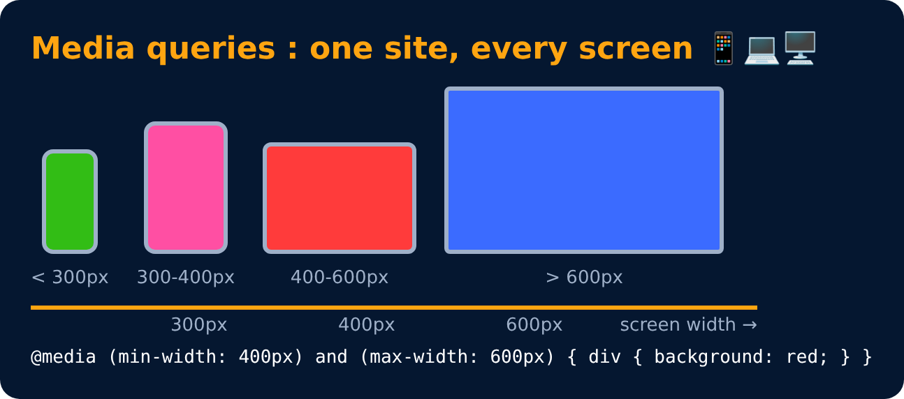

# Media Queries

<sub>Level 4 · Slide 71</sub>

Help create a **responsive** website

```css
@media (width : 600px) {
    div {
        background-color : red;
    }
}

@media (min-width : 600px) {
    div {
        background-color : red;
    }
}
```

> Today everyone has a different device: laptop, big monitor, iPhone, big or small Android phone, iPad, in landscape or portrait. The layout should look good on all of them, so the design must be **responsive**: it responds to different screen sizes & orientation.



---
[← Practice Set 6 🚀](70-practice-set-6.md) · [Level 4](README.md) · [Home](../README.md) · [Media Queries : range →](72-media-queries-range.md)
