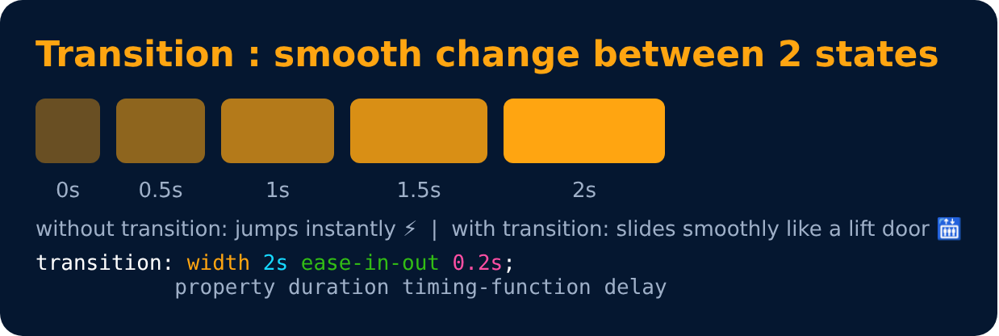
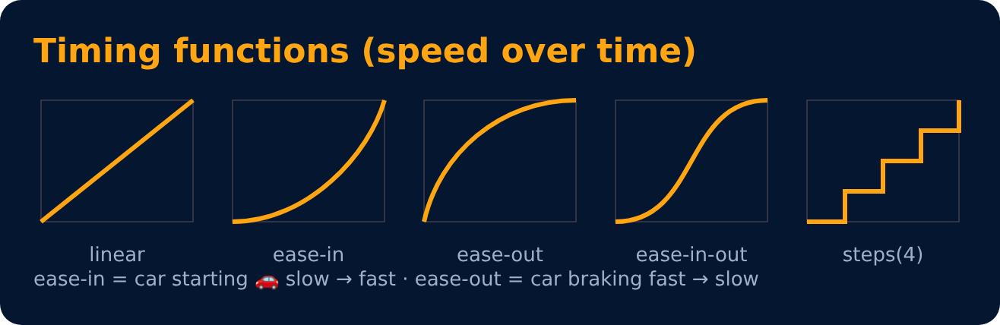

# Transitions

Transitions enable you to define the transition between two states of an element.

- **transition-property** : property you want to transition (font-size, width etc.)
- **transition-duration** : 2s / 4ms ..
- **transition-timing-function** : ease-in / ease-out / linear / steps ..
- **transition-delay** : 2s / 4ms ..

```css
div { width: 100px; transition-property: width; transition-duration: 2s; }
div:hover { width: 300px; }
```






---
[← Practice Set 7 🚀](../level-4/73-practice-set-7.md) · [Level 5](README.md) · [Home](../README.md) · [Transition Shorthand →](76-transition-shorthand.md)
