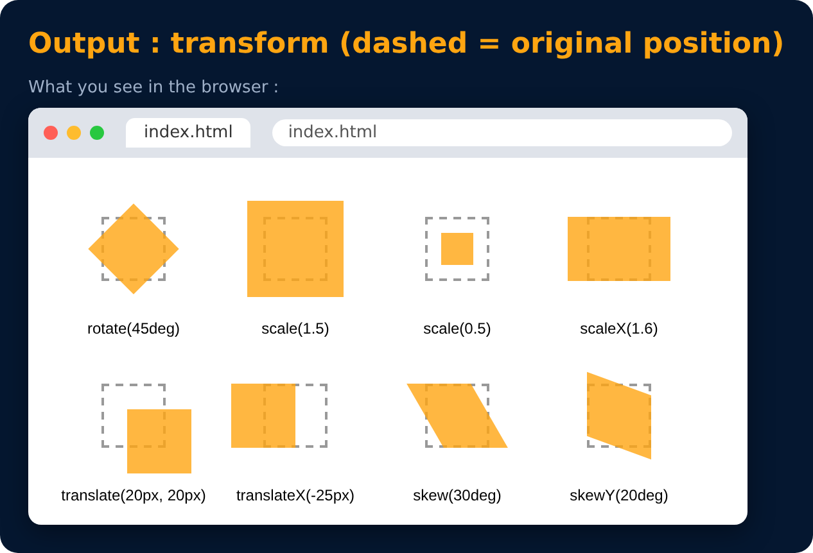

# CSS Transform : skew

```css
transform: skew(30deg);
```

> With transforms (and some maths 🙂) you can even build 3D objects.



---
[← CSS Transform : translate](79-css-transform-translate.md) · [Level 5](README.md) · [Home](../README.md) · [Animation →](81-animation.md)
