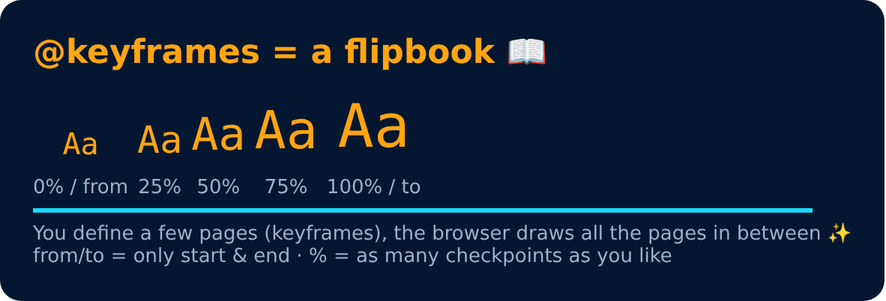

# Animation

<sub>Level 5 · Slide 81</sub>

To animate CSS elements

```css
@keyframes myName {
    from { font-size : 20px; }
    to { font-size : 40px; }
}
```



---
[← CSS Transform : skew](80-css-transform-skew.md) · [Level 5](README.md) · [Home](../README.md) · [Animation Properties →](82-animation-properties.md)
