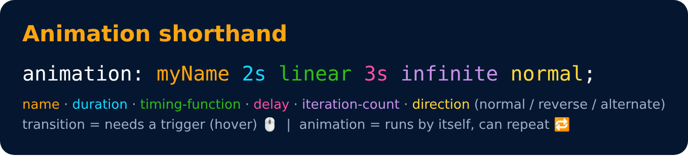

# Animation Shorthand

```css
animation : myName 2s linear 3s infinite normal
```



---
[← Animation Properties](82-animation-properties.md) · [Level 5](README.md) · [Home](../README.md) · [% in Animation →](84-percent-in-animation.md)
