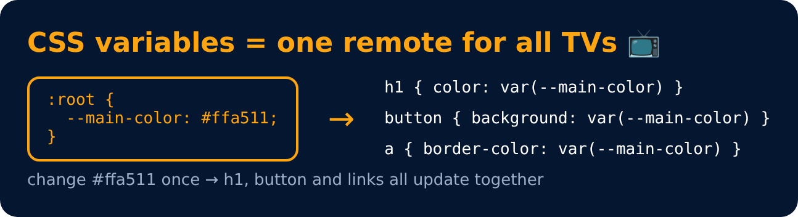

# CSS Variables

<sub>Level 5 · Slide 85</sub>

Store a value once, reuse it everywhere

```css
:root {
    --main-color : #ffa511;
    --gap : 20px;
}
h1 { color : var(--main-color); }
```

Change the variable once and every place using it updates



---
[← % in Animation](84-percent-in-animation.md) · [Level 5](README.md) · [Home](../README.md) · [Useful Properties →](86-useful-properties.md)
