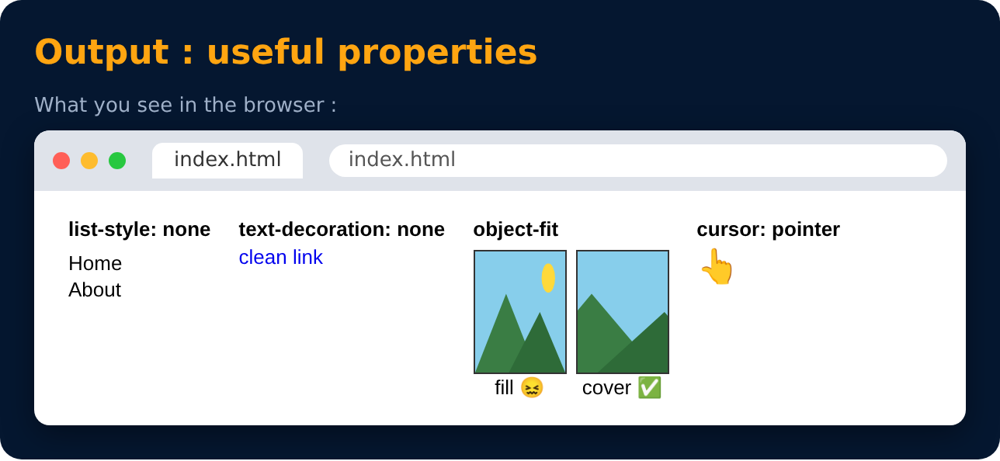

# Useful Properties

Level 5 · Slide 86

| Property | Use |
|---|---|
| `cursor : pointer;` | hand cursor on hover (buttons, links) |
| `list-style : none;` | removes bullets from ul / ol |
| `text-decoration : none;` | removes underline from links |
| `object-fit : cover;` | image fills its box without stretching |
| `outline : none;` | removes the focus outline |

---
[← CSS Variables](85-css-variables.md) · [Level 5](README.md) · [Home](../README.md) · [Practice Set 8 🚀 →](87-practice-set-8.md)
