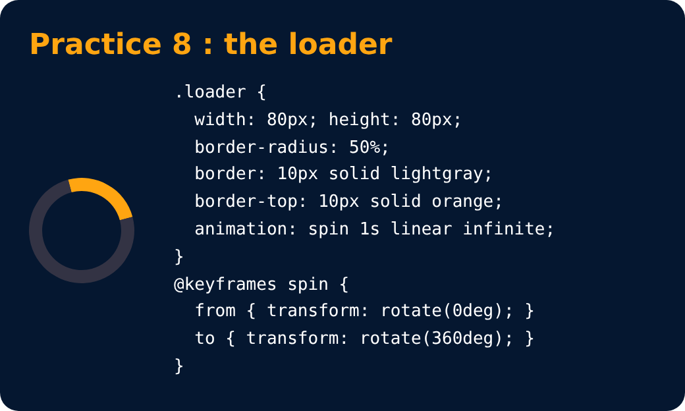

# Practice Set 8 🚀

<sub>Level 5 · Slide 87</sub>

**Qs:** Create a simple loader using CSS

- **Step1** : create a div with circular shape & a thick border from one end (top/bottom/left/right)
- **Step2** : To make it spin create an animation which transforms it from 0deg to 360deg
- **Step3** : Add the animation property to the loader with infinite duration

<details><summary>💡 Solution</summary>

```html
<div class="loader"></div>
```

```css
.loader {
  width: 80px;
  height: 80px;
  border-radius: 50%;
  border: 10px solid lightgray;
  border-top: 10px solid orange;
  animation: spin 1s linear infinite;
}
@keyframes spin {
  from { transform: rotate(0deg); }
  to   { transform: rotate(360deg); }
}
```



</details>

---
[← Useful Properties](86-useful-properties.md) · [Level 5](README.md) · [Home](../README.md)
