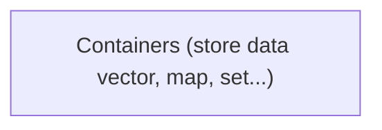
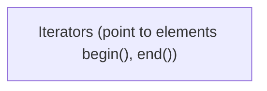
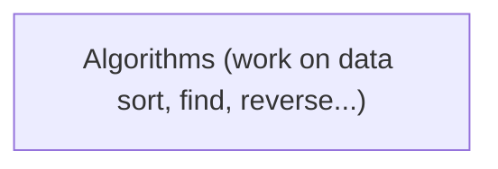

# What is STL?

*Ready-made, tested, fast tools*

- **Containers** hold data, **algorithms** process it, **iterators** connect the two
- Templates = works with any type : `vector<int>`, `vector<string>`

> **Why :** Writing your own linked list / heap / BST in a contest wastes time. STL gives them in one line.

---
[← OOP in One Slide](../level-03-pointers-memory-structs/04-oop-in-one-slide.md) | [Level 4 index](README.md) | [All levels](../README.md) | [pair →](../level-04-stl-basics/02-pair.md)
