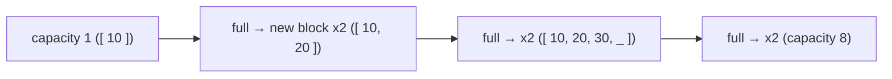

# How vector Grows

*Why push_back is O(1) 'amortized'*

- When full, vector allocates a **bigger block** (usually 2x) and copies everything - O(n) once in a while
- Spread over all pushes, that's still **O(1) on average** = amortized O(1)
- **v.reserve(n)** - allocate once upfront if you know the size

---
[← vector](../level-04-stl-basics/03-vector.md) | [Level 4 index](README.md) | [All levels](../README.md) | [2D vector →](../level-04-stl-basics/05-2d-vector.md)
