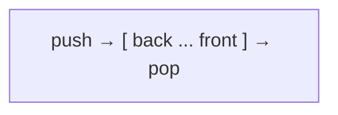

# queue & deque

```cpp
// queue - First In, First Out
queue<int> q;
q.push(1); q.push(2);
q.front();    // 1
q.back();     // 2
q.pop();      // removes 1
// used in BFS, scheduling
```

```cpp
// deque - add/remove at BOTH ends
deque<int> dq;
dq.push_back(1);
dq.push_front(0);
dq.pop_back();
dq.pop_front();
dq[0];        // random access too
// used in sliding window max
```



---
[← stack](../level-05-stl-containers/01-stack.md) | [Level 5 index](README.md) | [All levels](../README.md) | [priority_queue →](../level-05-stl-containers/03-priority-queue.md)
