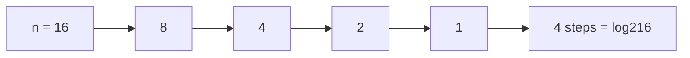

# Pattern 3 : Halving or Doubling

*Gives O(log n)*

```cpp
for (int i = 1; i < n; i *= 2) {
    // O(1)
}
// i = 1, 2, 4, 8 ... < n
// how many doublings to reach n?
// 2^k = n  ->  k = log2(n)
// O(log n)
```

```cpp
while (n > 0) {
    n /= 2;          // halve every time
}
// O(log n)

while (n > 0) {
    n /= 10;         // count digits
}
// O(log10 n) = O(log n)
```



---
[← Pattern 2 : Nested Loops](../level-08-how-to-find-time-complexity/02-pattern-2-nested-loops.md) | [Level 8 index](README.md) | [All levels](../README.md) | [Pattern 4 : Mixed Loops →](../level-08-how-to-find-time-complexity/04-pattern-4-mixed-loops.md)
