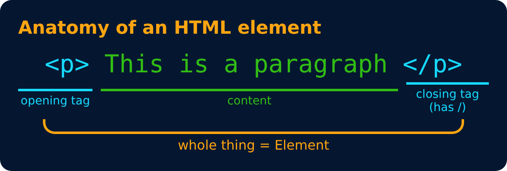

# HTML Element

An HTML element is a complete structure that usually consists of an opening tag, content, and a closing tag. It can also contain other HTML elements. However, some elements, such as `````` and ```<br>```, do not have closing tags.

# HTML tag

An HTML tag is a keyword enclosed in angle brackets (< >) used to define HTML elements.

```html
<p> This is a paragraph </p>
```



---
[← First HTML File](04-first-html-file.md) · [Level 1](README.md) · [Home](../README.md) · [Basic HTML Page →](06-basic-html-page.md)
