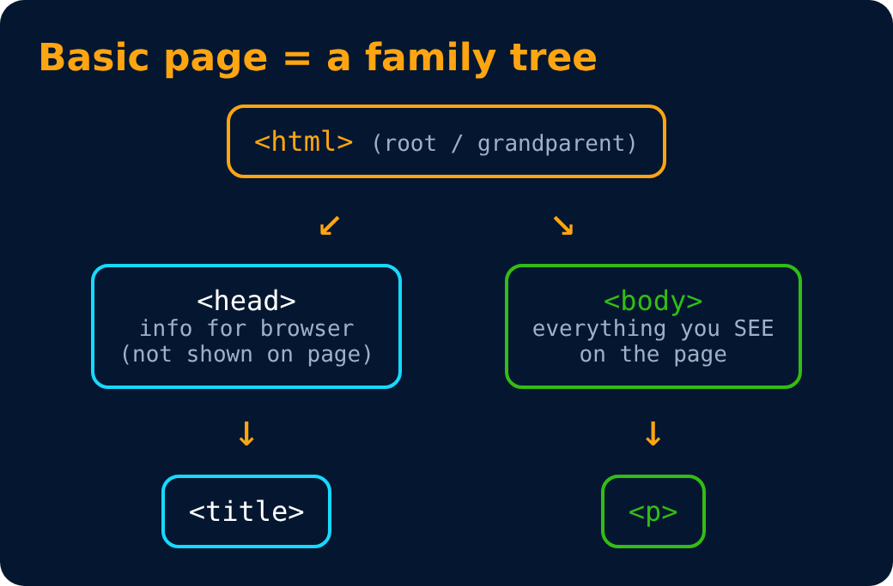

# Basic HTML Page

```html
<!DOCTYPE html>                    <!-- tells browser you are using HTML5 -->
<html>                             <!-- root of an html document -->
  <head>                           <!-- container for metadata -->
    <title>My First Page</title>   <!-- page title -->
  </head>
  <body>                           <!-- contains all data rendered(Displayed on the screen by the browser) by the browser -->
    <p>hello world</p>             <!-- paragraph tag -->
  </body>
</html>
```




> 💡 Notice: the `<title>` shows on the **browser tab**, not on the page.

---
[← HTML Tag](05-html-tag.md) · [Level 1](README.md) · [Home](../README.md) · [Meta Tags →](07-meta-tags.md)
