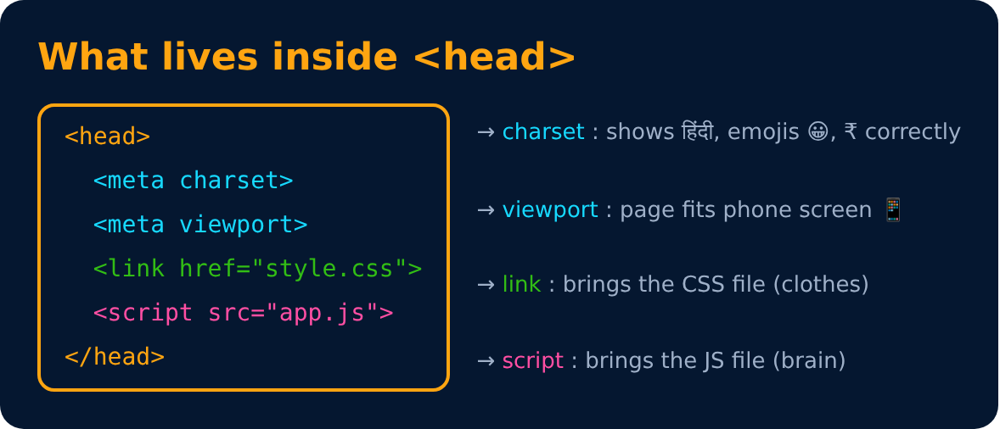
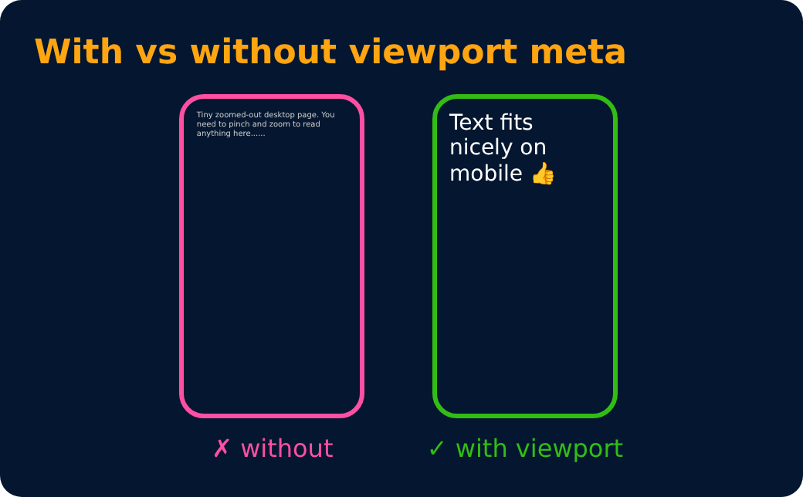

# Meta Tags

Extra info about the page, written inside `<head>`.

```html
<meta charset="UTF-8"> <!-- tells the browser to display text, different languages, and special symbols correctly. -->
<meta name="viewport" content="width=device-width, initial-scale=1.0">  <!-- This tag tells the browser to match the webpage’s width to the device’s screen width. -->
<link rel="stylesheet" href="style.css"> <!-- rel="stylesheet" tells the browser that the linked file contains CSS styles. -->
<script src="app.js"></script>
```

**charset** = all characters &nbsp;&nbsp; **viewport** = fits mobile screen






---
[← Basic HTML Page](06-basic-html-page.md) · [Level 1](README.md) · [Home](../README.md) · [Quick Points 🚀 →](08-quick-points.md)
