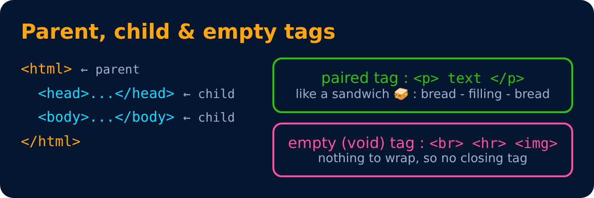
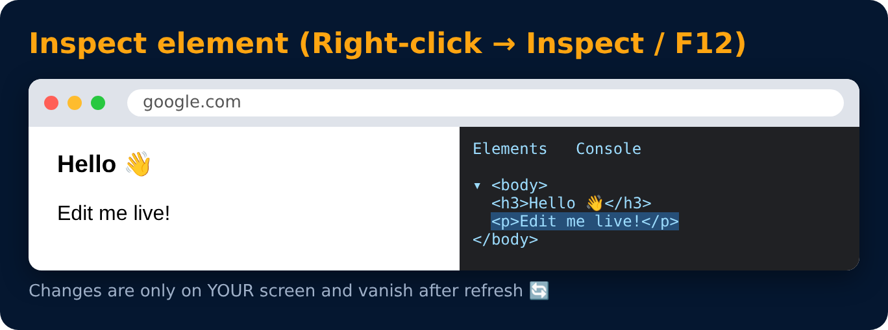

# Quick Points 🚀

- Html tag is parent of head & body tag
- Most of html elements have opening & closing tags with content in between
- Some tags have no content in between, eg - ` `
- We can use inspect element/view page source to edit html

---
[← Meta Tags](07-meta-tags.md) · [Level 1](README.md) · [Home](../README.md) · [Comments in HTML →](09-comments-in-html.md)
