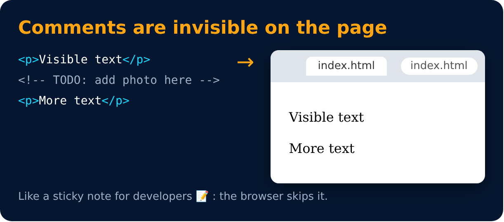

# Comments in HTML

This is part of code that should not be parsed.

```html
<!-- This is an HTML Comment -->
```



> ⌨️ Shortcut in VS Code: `Ctrl + /` comments / uncomments a line.

---
[← Quick Points 🚀](08-quick-points.md) · [Level 1](README.md) · [Home](../README.md) · [HTML is NOT case sensitive →](10-html-is-not-case-sensitive.md)
