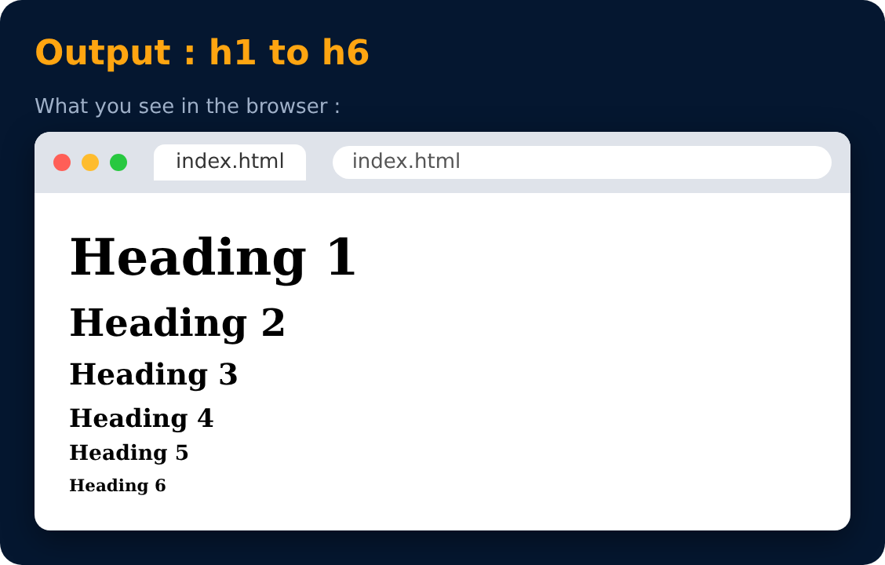

# Heading Tag

Used to display headings in HTML.

| Tag | |
|---|---|
| `h1` | (most important) |
| `h2` | |
| `h3` | |
| `h4` | |
| `h5` | |
| `h6` | (least important) |

```html
<h1>Heading 1</h1>
<h2>Heading 2</h2>
...
<h6>Heading 6</h6>
```



> 💡 Use only **one `<h1>`** per page (like one title per book).

---
[← Basic HTML Tags](12-basic-html-tags.md) · [Level 2](README.md) · [Home](../README.md) · [Paragraph Tag →](14-paragraph-tag.md)
