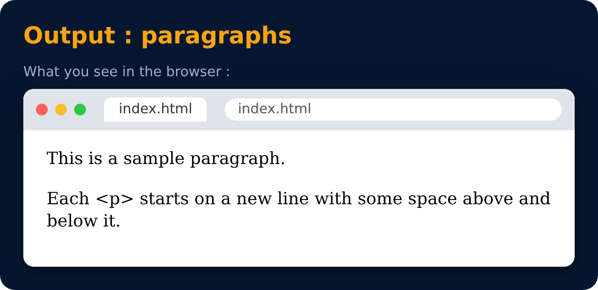

# Paragraph Tag

Used to add paragraphs in HTML.

```html
<p> This is a sample paragraph </p>
```



---
[← Heading Tag](13-heading-tag.md) · [Level 2](README.md) · [Home](../README.md) · [Anchor Tag →](15-anchor-tag.md)
