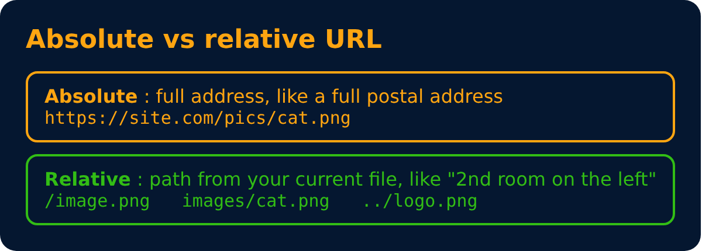

# Image Tag

Used to add images to your page.

```html

```

`/image.png` → relative url




---
[← Anchor Tag](15-anchor-tag.md) · [Level 2](README.md) · [Home](../README.md) · [Br Tag →](17-br-tag.md)
