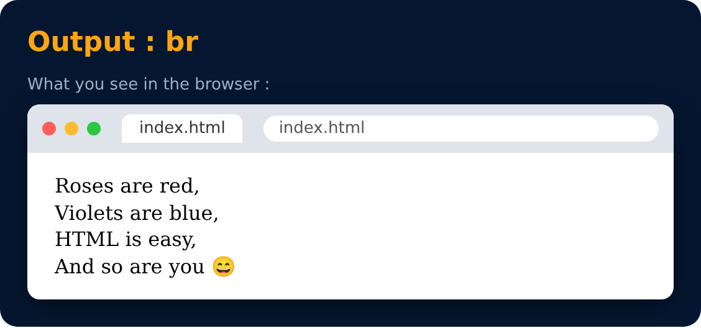

# Br Tag

Used to add next line (line breaks) to your page.

```html
<br>
```



---
[← Image Tag](16-image-tag.md) · [Level 2](README.md) · [Home](../README.md) · [Bold, Italic & Underline Tags →](18-bold-italic-and-underline-tags.md)
