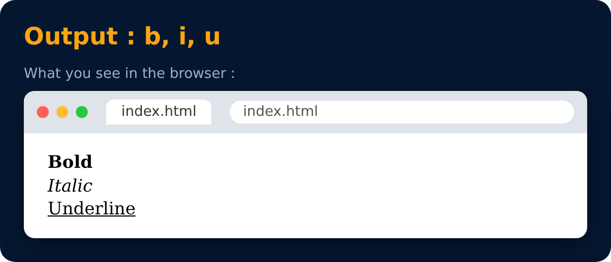

# Bold, Italic & Underline Tags

Used to highlight text in your page.

```html
<b> Bold </b>
<i> Italic </i>
<u> Underline </u>
```



---
[← Br Tag](17-br-tag.md) · [Level 2](README.md) · [Home](../README.md) · [Strong, Em & Mark Tags →](19-strong-em-and-mark-tags.md)
