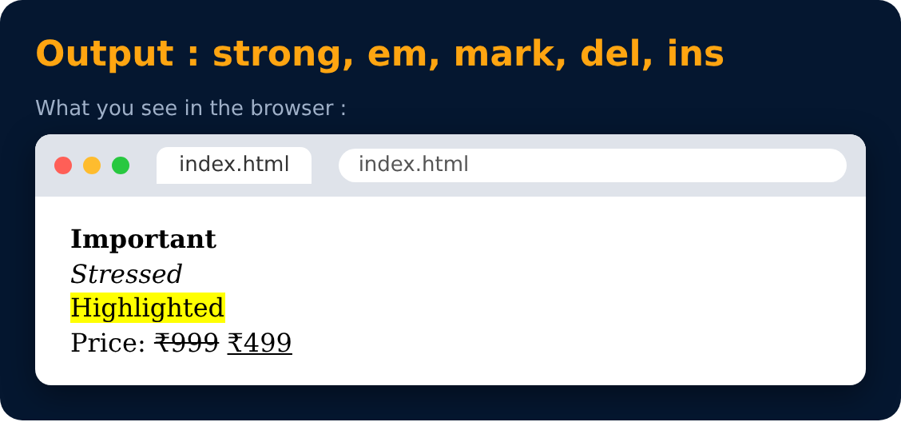
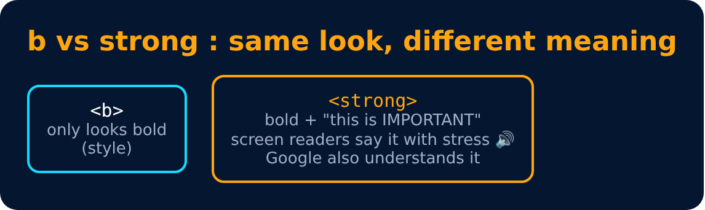

# Strong, Em & Mark Tags

Like bold & italic, but they also tell the meaning.

```html
<strong> Important </strong>
<em> Stressed </em>
<mark> Highlighted </mark>
<del> Old price </del>    <ins> New price </ins>
```






---
[← Bold, Italic & Underline Tags](18-bold-italic-and-underline-tags.md) · [Level 2](README.md) · [Home](../README.md) · [Big & Small Tags →](20-big-and-small-tags.md)
