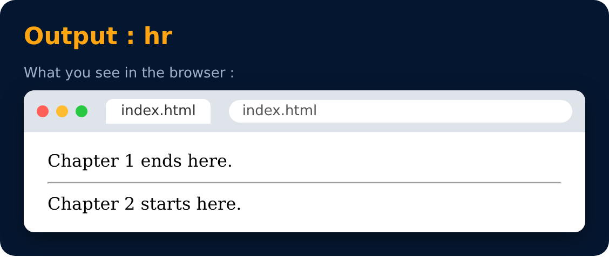

# Hr Tag

Used to display a horizontal ruler, used to separate content.

```html
<hr>
```



---
[← Big & Small Tags](20-big-and-small-tags.md) · [Level 2](README.md) · [Home](../README.md) · [Subscript & Superscript Tag →](22-subscript-and-superscript-tag.md)
