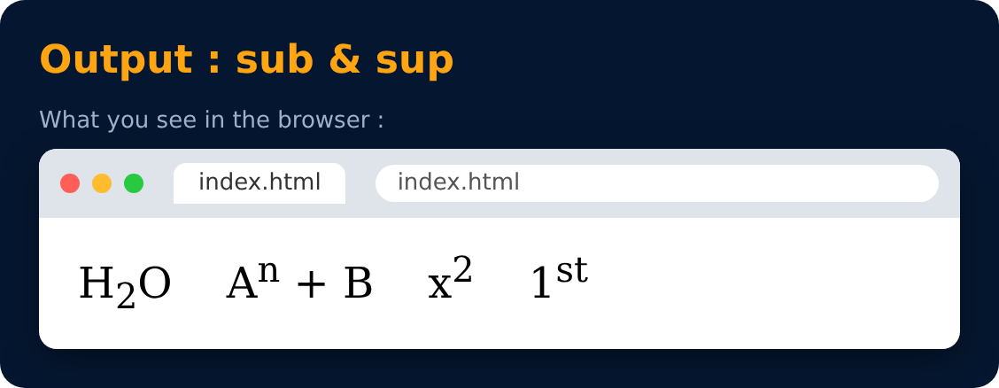

# Subscript & Superscript Tag

Used to write text slightly below or above the line.

```html
<sub> subscript </sub>      <!-- H<sub>2</sub>O -->
<sup> superscript </sup>    <!-- A<sup>n</sup> + B -->
```



---
[← Hr Tag](21-hr-tag.md) · [Level 2](README.md) · [Home](../README.md) · [Pre Tag →](23-pre-tag.md)
