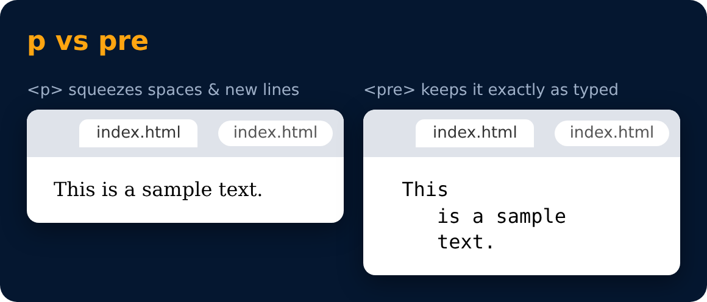

# Pre Tag

Used to display text as it is (without ignoring spaces & next line).

```html
<pre> This
    is a sample
    text.
</pre>
```



---
[← Subscript & Superscript Tag](22-subscript-and-superscript-tag.md) · [Level 2](README.md) · [Home](../README.md) · [Important Questions ❓ →](24-important-questions.md)
