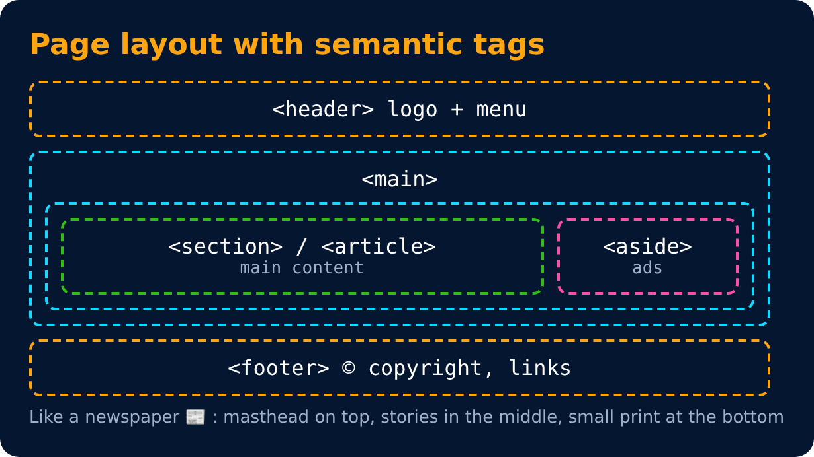
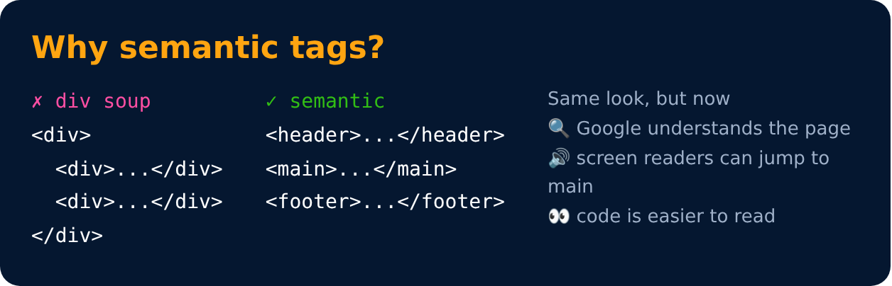

# Page Layout Techniques

- using **Semantic tags**(A semantic tag clearly describes the meaning of its content to the browser and developers.) for layout
- using the **Right Tags**

```html
<header>
<main>
<footer>
```






---
[← Important Questions ❓](../level-2/24-important-questions.md) · [Level 3](README.md) · [Home](../README.md) · [Inside Main Tag →](26-inside-main-tag.md)
