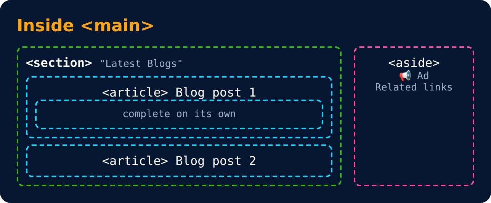

# Inside Main Tag

| Tag | Use |
|---|---|
| **Section Tag** `<section>` | For a section on your page |
| **Article Tag** `<article>` | For an article on your page |
| **Aside Tag** `<aside>` | For content aside main content (ads) |

---
[← Page Layout Techniques](25-page-layout-techniques.md) · [Level 3](README.md) · [Home](../README.md) · [Revisiting Anchor Tag →](27-revisiting-anchor-tag.md)
