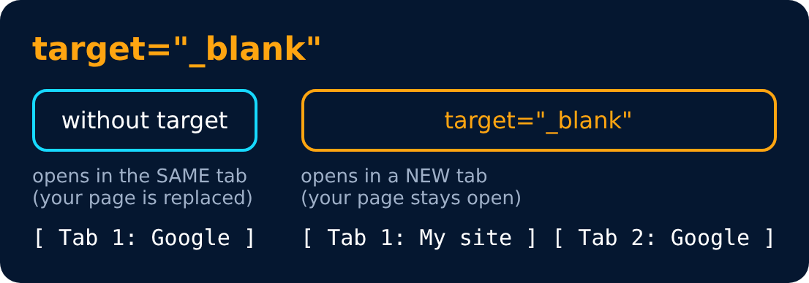

# Revisiting Anchor Tag

```html
<a href="https://google.com" target="_blank"> Google </a>
```

`target="_blank"` → for new tab

```html
<a href="https://google.com">  </a>
```

→ clickable pic



---
[← Inside Main Tag](26-inside-main-tag.md) · [Level 3](README.md) · [Home](../README.md) · [Revisiting Image Tag →](28-revisiting-image-tag.md)
