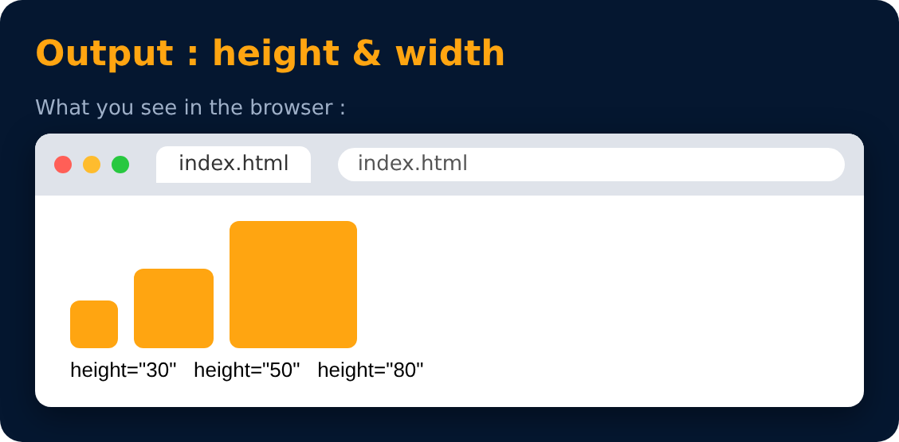

# Revisiting Image Tag

```html

```

→ set height

```html

```

→ set width



> 💡 Give only one of height or width, and the image keeps its shape (no stretching).

---
[← Revisiting Anchor Tag](27-revisiting-anchor-tag.md) · [Level 3](README.md) · [Home](../README.md) · [Div Tag →](29-div-tag.md)
