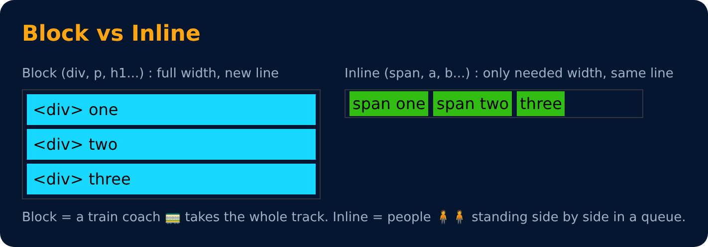

# Div Tag

Div is a container used for other HTML elements.

**Block Element** (takes full width)

---
[← Revisiting Image Tag](28-revisiting-image-tag.md) · [Level 3](README.md) · [Home](../README.md) · [List : Div Tags →](30-list-div-tags.md)
