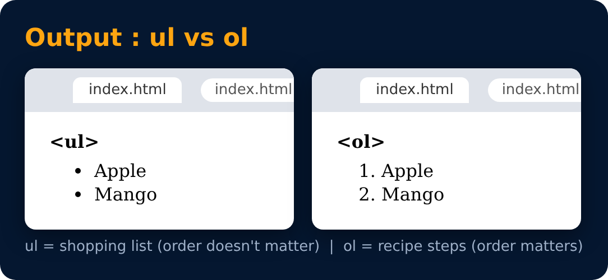

# List in HTML

Lists are used to represent real life list data.

| unordered | ordered |
|---|---|
| <pre>&lt;ul&gt;   &lt;li&gt; Apple &lt;/li&gt;   &lt;li&gt; Mango &lt;/li&gt; &lt;/ul&gt;</pre> | <pre>&lt;ol&gt;   &lt;li&gt; Apple &lt;/li&gt;   &lt;li&gt; Mango &lt;/li&gt; &lt;/ol&gt;</pre> |

---
[← Important Questions ❓](../level-3/33-important-questions.md) · [Level Pro](README.md) · [Home](../README.md) · [Tables in HTML →](35-tables-in-html.md)
