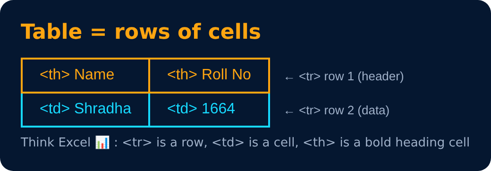

# Tables in HTML

Tables are used to represent real life table data.

| Tag | |
|---|---|
| `<tr>` | used to display table row |
| `<td>` | used to display table data |
| `<th>` | used to display table header |

---
[← List in HTML](34-list-in-html.md) · [Level Pro](README.md) · [Home](../README.md) · [Tables in HTML (Example) →](36-tables-in-html-example.md)
