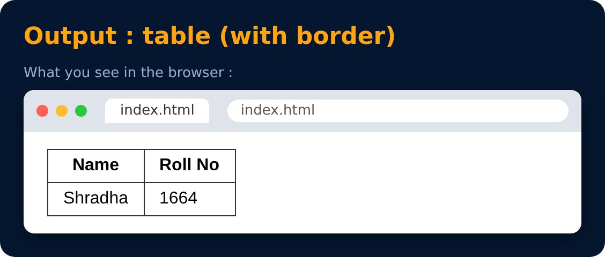

# Tables in HTML (Example)

```html
<table>
  <tr>
    <th> Name </th>
    <th> Roll No </th>
  </tr>
  <tr>
    <td> Shradha </td>
    <td> 1664 </td>
  </tr>
</table>
```



> 💡 Borders don't show by default. Add them with CSS: `table, th, td { border: 1px solid black; }`

---
[← Tables in HTML](35-tables-in-html.md) · [Level Pro](README.md) · [Home](../README.md) · [Caption in Tables →](37-caption-in-tables.md)
