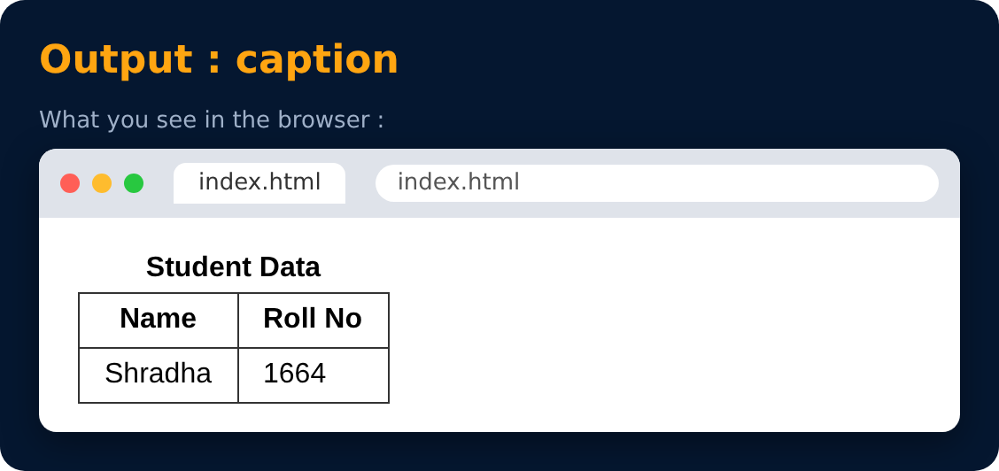

# Caption in Tables

```html
<caption> Student Data </caption>
```



---
[← Tables in HTML (Example)](36-tables-in-html-example.md) · [Level Pro](README.md) · [Home](../README.md) · [thead & tbody in Tables →](38-thead-and-tbody-in-tables.md)
