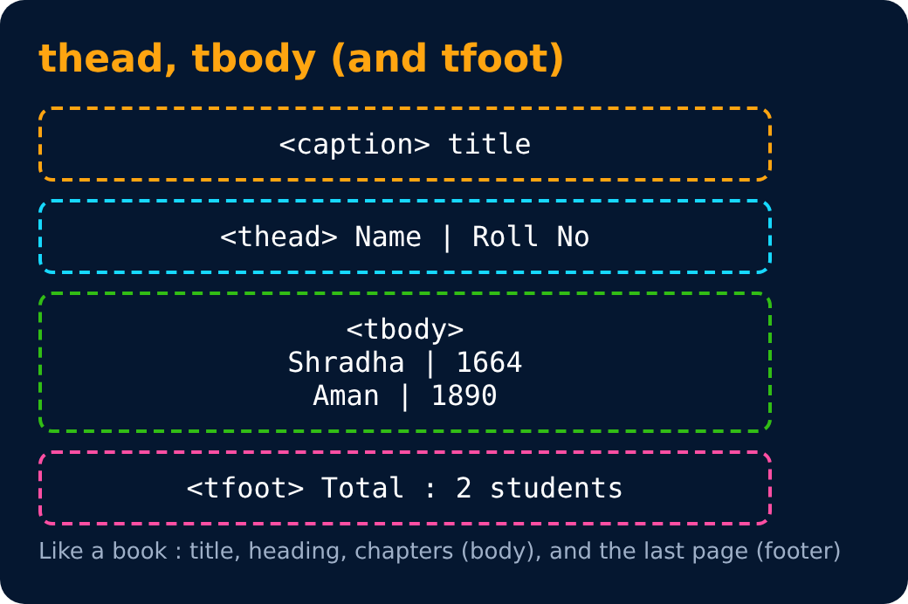

# thead & tbody in Tables

`<thead>` to wrap table head

`<tbody>` to wrap table body

```html
<table>
  <thead>
    <tr> <th> Name </th> <th> Roll No </th> </tr>
  </thead>
  <tbody>
    <tr> <td> Shradha </td> <td> 1664 </td> </tr>
  </tbody>
</table>
```



---
[← Caption in Tables](37-caption-in-tables.md) · [Level Pro](README.md) · [Home](../README.md) · [colspan attribute →](39-colspan-attribute.md)
