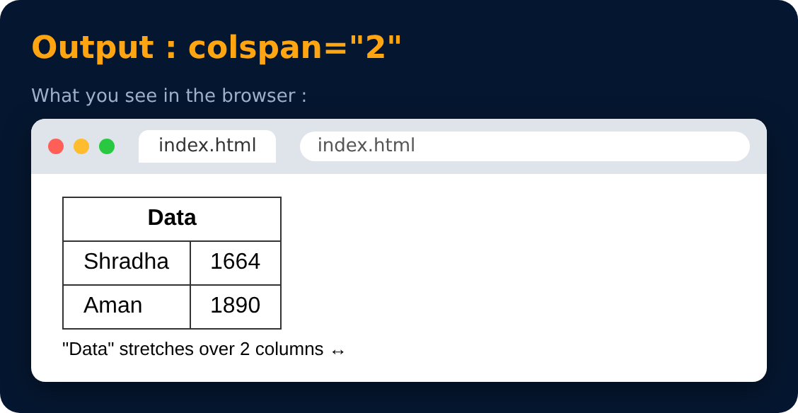

# colspan attribute

`colspan="n"`

used to create cells which spans over multiple columns

```html
<tr> <th colspan="2"> Data </th> </tr>
<tr> <td> Shradha </td> <td> 1664 </td> </tr>
<tr> <td> Aman </td>    <td> 1890 </td> </tr>
```



---
[← thead & tbody in Tables](38-thead-and-tbody-in-tables.md) · [Level Pro](README.md) · [Home](../README.md) · [rowspan attribute →](40-rowspan-attribute.md)
