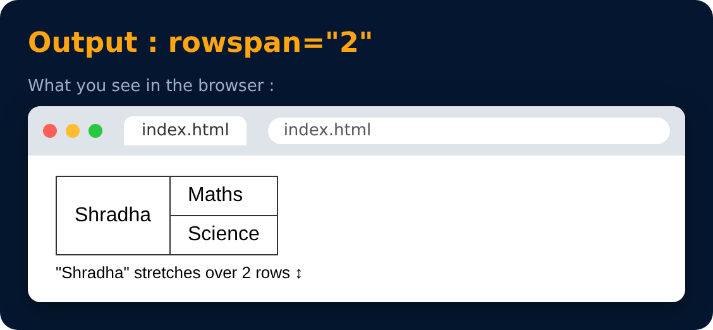

# rowspan attribute

`rowspan="n"`

used to create cells which spans over multiple rows

```html
<tr>
  <td rowspan="2"> Shradha </td> <td> Maths </td>
</tr>
<tr> <td> Science </td> </tr>
```



---
[← colspan attribute](39-colspan-attribute.md) · [Level Pro](README.md) · [Home](../README.md) · [Form in HTML →](41-form-in-html.md)
