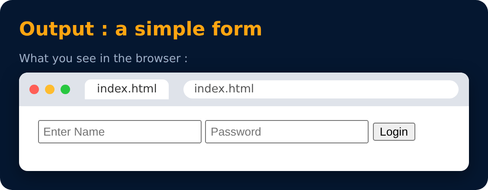

# Form in HTML

Forms are used to collect data from the user

Eg- sign up/login/help requests/contact me

```html
<form>
  form content
</form>
```




---
[← rowspan attribute](40-rowspan-attribute.md) · [Level Pro](README.md) · [Home](../README.md) · [Action in Form →](42-action-in-form.md)
