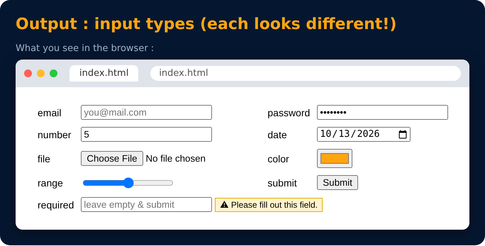

# More Input Types

```html
<input type="email">     <input type="password">
<input type="number">    <input type="date">
<input type="file">      <input type="color">
<input type="range">     <input type="submit">

<input type="text" required>   <!-- must be filled -->
```



---
[← Form Element : Input](44-form-element-input.md) · [Level Pro](README.md) · [Home](../README.md) · [Label →](46-label.md)
