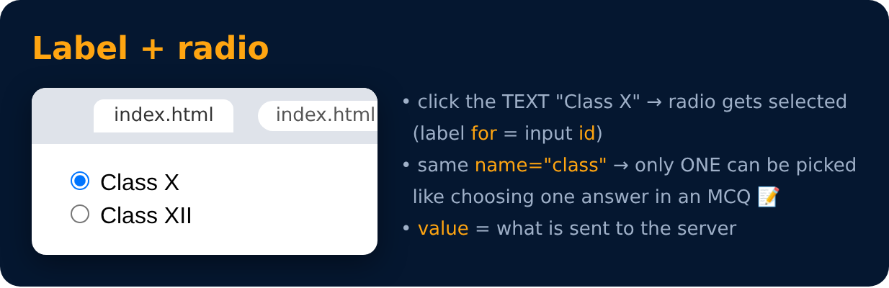

# Label

```html
<label for="id1">
  <input type="radio" value="class X" name="class" id="id1">
  Class X
</label>

<label for="id2">
  <input type="radio" value="class XII" name="class" id="id2">
  Class XII
</label>
```



---
[← More Input Types](45-more-input-types.md) · [Level Pro](README.md) · [Home](../README.md) · [Class & Id →](47-class-and-id.md)
