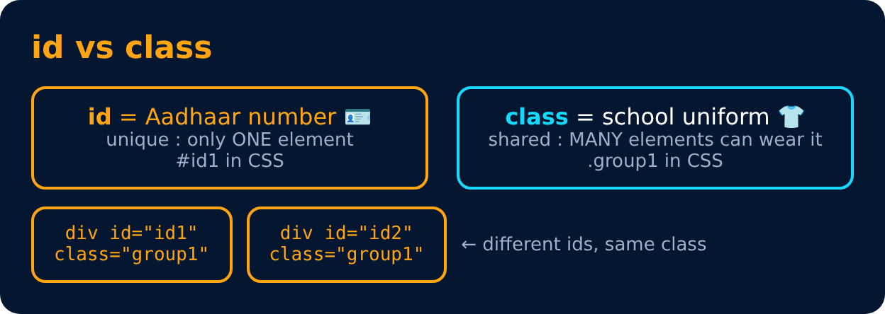

# Class & Id

```html
<div id="id1" class="group1">
</div>

<div id="id2" class="group1">
</div>
```



---
[← Label](46-label.md) · [Level Pro](README.md) · [Home](../README.md) · [Checkbox →](48-checkbox.md)
