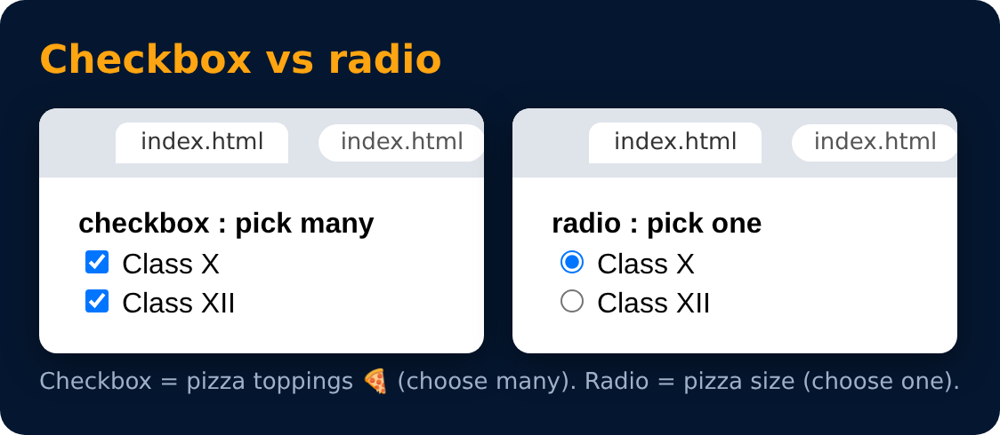

# Checkbox

```html
<label for="id1">
  <input type="checkbox" value="class X" name="class" id="id1">
  Class X
</label>

<label for="id2">
  <input type="checkbox" value="class XII" name="class" id="id2">
  Class XII
</label>
```



---
[← Class & Id](47-class-and-id.md) · [Level Pro](README.md) · [Home](../README.md) · [Textarea →](49-textarea.md)
