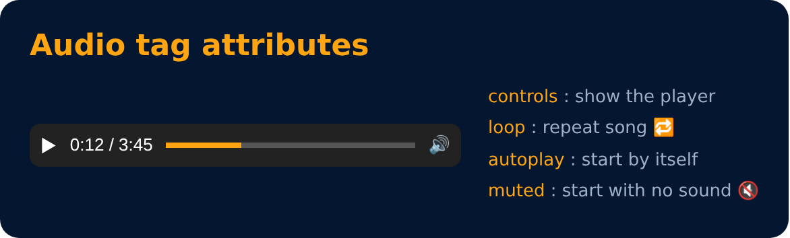

# Audio Tag

```html
<audio src="song.mp3"> My Audio </audio>
```

**Attributes**
- controls
- loop
- autoplay
- muted



---
[← Video Tag](52-video-tag.md) · [Level Pro](README.md) · [Home](../README.md) · [Source Tag →](54-source-tag.md)
