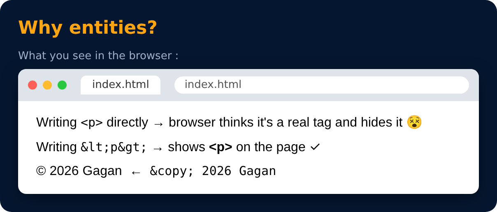

# HTML Entities

Used to show special characters on the page

| Entity | shows |
|---|---|
| `&lt;` | < |
| `&gt;` | > |
| `&amp;` | & |
| `&copy;` | © |
| `&nbsp;` | extra space |

---
[← Source Tag](54-source-tag.md) · [Level Pro](README.md) · [Home](../README.md) · [Important Questions ❓ →](56-important-questions.md)
