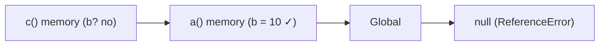

# Scope Chain

*How JS finds a variable*

```js
function a() {
  var b = 10;
  c();
  function c() {
    console.log(b);
  }
}
a();   // 10
```

- Looking for **b** inside c()...
- 1. c() memory - not found
- 2. a() memory - `found b = 10`
- If not found : Global → null → ReferenceError



- **Lexical Environment** = local memory + reference to the parent's lexical environment
- This chain of references is the **Scope Chain**

> **Example :** Lost pen? Check your bag → your friend's bag → teacher's desk → give up.

---
[← Scope](../level-04-scope-let-const/01-scope.md) | [Level 4 index](README.md) | [All levels](../README.md) | [Where Variables Live →](../level-04-scope-let-const/03-where-variables-live.md)
