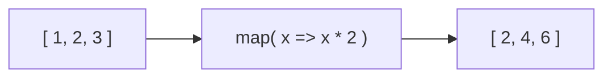

# map

*Transform EVERY item → new array, same length*



```js
const arr = [5, 1, 3];
arr.map((x) => x * 2);           // [10, 2, 6]
arr.map((x) => x.toString(2));   // ["101", "1", "11"]   binary
users.map((u) => u.firstName + " " + u.lastName);
```

---
[← Practice Set 5](../level-05-functions-deep-dive/17-practice-set-5.md) | [Level 6 index](README.md) | [All levels](../README.md) | [filter →](../level-06-map-filter-reduce/02-filter.md)
