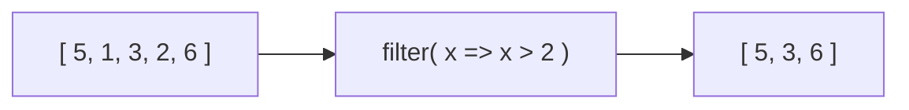

# filter

*KEEP only items that pass → new array, same or smaller*



```js
const arr = [5, 1, 3, 2, 6];
arr.filter((x) => x % 2);        // [5, 1, 3]  odd
arr.filter((x) => x % 2 === 0);  // [2, 6]     even
users.filter((u) => u.age < 30);
```

---
[← map](../level-06-map-filter-reduce/01-map.md) | [Level 6 index](README.md) | [All levels](../README.md) | [reduce →](../level-06-map-filter-reduce/03-reduce.md)
