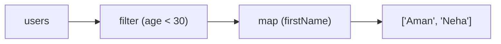

# Chaining

*Output of one becomes input of the next*



```js
const names = users
  .filter((u) => u.age < 30)
  .map((u) => u.firstName);

const totalMarks = students
  .filter((s) => s.passed)
  .map((s) => s.marks)
  .reduce((a, b) => a + b, 0);
```

---
[← find, some, every, forEach](../level-06-map-filter-reduce/05-find-some-every-foreach.md) | [Level 6 index](README.md) | [All levels](../README.md) | [Polyfill of map →](../level-06-map-filter-reduce/07-polyfill-of-map.md)
