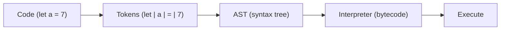

# Inside the Engine

*3 steps : Parsing → Compilation → Execution*

- **Parsing** - code is split into tokens and turned into an Abstract Syntax Tree
- **JIT Compilation** - interpreter starts fast, compiler optimises hot code while it runs
- **Execution** - uses the Memory Heap & Call Stack. **Garbage collector** uses Mark & Sweep

---
[← JS Runtime Environment](../level-09-inside-the-js-engine/01-js-runtime-environment.md) | [Level 9 index](README.md) | [All levels](../README.md) | [Google's V8 →](../level-09-inside-the-js-engine/03-google-s-v8.md)
